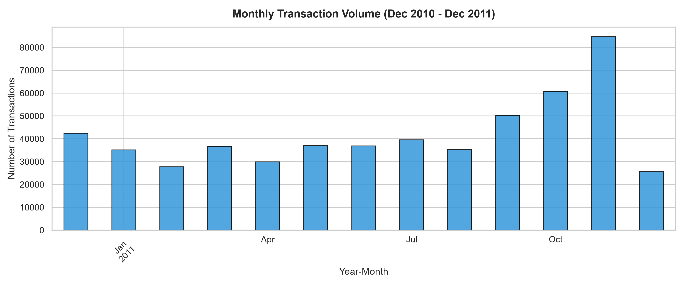
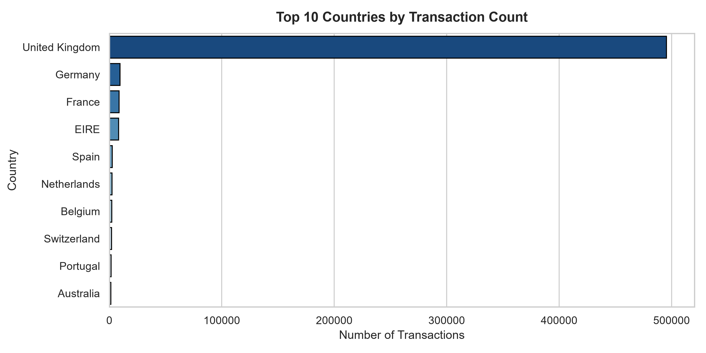
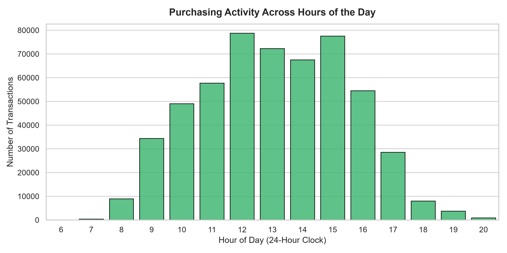
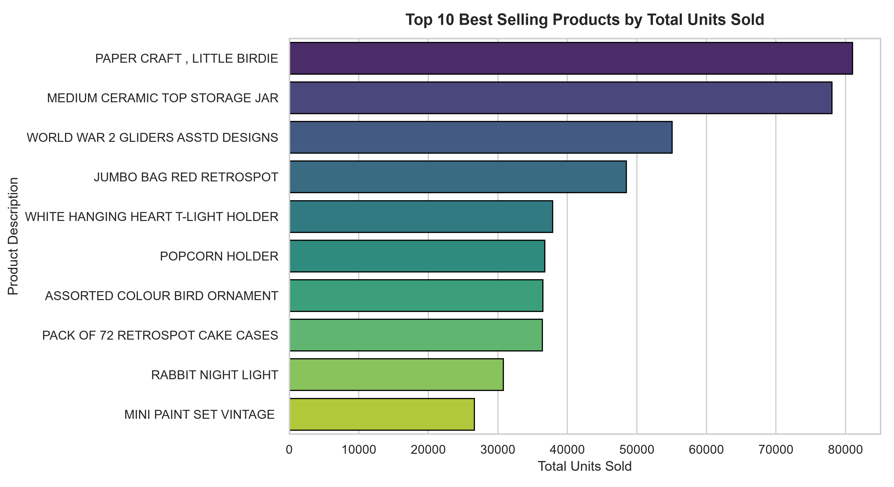

# E-Commerce Sales Exploratory Data Analysis (EDA)


---

## Internship Task Information
- **Organization:** CodeAlpha
- **Internship Role:** Data Analytics Intern
- **Task Assigned:** Task 2 — Exploratory Data Analysis (EDA)
- **Domain:** E-Commerce & Retail Analytics
- **Project Name:** E-Commerce Sales Exploratory Data Analysis

---

## Project Overview & Objectives
This project performs an exploratory data analysis (EDA) on an international online retail dataset from the UCI Machine Learning Repository. The objective is to understand transaction structure, assess data quality, evaluate sales trends over time, identify customer market concentrations, uncover product performance metrics, and investigate return patterns and cancellations.

### Key Analytical Goals:
1. **Data Inspection & Quality Assurance:** Examine schema, dimensions, data types, missing records, and duplicate entries.
2. **Transaction Behavior & Anomalies:** Identify cancellations (invoices prefixed with `'C'`), negative quantities, and unusual unit prices without blindly removing valid business records.
3. **Temporal Sales Patterns:** Analyze transaction volume across months, days of the week, and hours of the day.
4. **Geographic Distribution:** Quantify transaction volumes across international markets versus the domestic UK market.
5. **Product Performance:** Identify top-selling items by physical volume and financial contribution.
6. **Financial Metrics:** Distinguish gross transaction volume from net sales after accounting for returns and cancellations.

---

## Technology Stack
- **Language:** Python (3.9+)
- **Data Manipulation:** `pandas`, `numpy`
- **Visualization:** `matplotlib`, `seaborn`
- **Interactive Environment:** `jupyter notebook`, `ipykernel`
- **File Parser:** `openpyxl` (for `.xlsx` workbook handling)

---

## Dataset Source & Download Instructions

The dataset used in this project is the **Online Retail Dataset** provided by the UCI Machine Learning Repository.

- **Repository:** [UCI Machine Learning Repository — Online Retail](https://archive.ics.uci.edu/dataset/352/online+retail)
- **Timeframe:** 01/12/2010 to 09/12/2011 (373 days total)
- **Format:** Excel (`.xlsx`), ~23.7 MB

### Setup Instructions for Dataset:
Because large binary files are excluded from git version control via `.gitignore`, download the original Excel workbook and place it in the `data/` folder:
1. Download `Online Retail.xlsx` from the [UCI link](https://archive.ics.uci.edu/dataset/352/online+retail).
2. Move or copy the file into:
   ```text
   CodeAlpha_EDA/data/Online Retail.xlsx
   ```
*(The original dataset is kept strictly read-only and is never altered during analysis).*

---

## Project Folder Structure

```text
CodeAlpha_EDA/
├── data/
│   ├── .gitkeep                   # Tracks the data folder in git
│   └── Online Retail.xlsx         # Original dataset (downloaded locally)
├── notebooks/
│   ├── .gitkeep
│   └── eda_analysis.ipynb         # Fully executed Jupyter Notebook with EDA workflows
├── outputs/
│   ├── .gitkeep
│   ├── hourly_purchasing_activity.png
│   ├── monthly_transaction_volume.png
│   ├── top_10_countries.png
│   └── top_10_products_by_quantity.png
├── .gitignore                     # Excludes virtual environments and large raw datasets
├── README.md                      # Comprehensive project documentation & findings
└── requirements.txt               # Required Python packages with version constraints
```

---

## Installation & Execution

### 1. Clone or Open the Repository
```bash
git clone <your-repository-url>
cd CodeAlpha_EDA
```

### 2. Set Up a Virtual Environment (Recommended)
**Windows (PowerShell):**
```powershell
python -m venv .venv
.\.venv\Scripts\Activate.ps1
```

**macOS / Linux:**
```bash
python3 -m venv .venv
source .venv/bin/activate
```

### 3. Install Dependencies
```bash
pip install -r requirements.txt
```

### 4. Launch Jupyter Notebook
```bash
jupyter notebook
```
Open `notebooks/eda_analysis.ipynb` and select **Kernel > Restart & Run All** to reproduce the analysis and charts.

---

## Data Cleaning & Quality Methodology

A core tenet of this exploratory analysis is **non-destructive data inspection**:
- **Preserving Context:** We do not blindly drop negative quantities or cancelled orders. Dropping negative quantities without understanding them would artificially inflate sales numbers and hide true cancellation rates.
- **Missing Value Context:** 
  - `CustomerID`: Missing in **135,080** records (24.93%). These represent transactions by guest shoppers who checked out without creating an account. These records represent actual retail sales and are retained for revenue and volume trends.
  - `Description`: Missing in **1,454** records (0.27%). Most correspond to damaged stock or administrative write-offs.
- **Duplicate Records:** **5,268** rows (0.97%) were identified as duplicate entries.
- **Cancellation Separation:** Invoices prefixed with the letter `'C'` (9,288 orders) were flagged as confirmed customer cancellations and returns. All 9,288 have negative quantities.
- **Inventory Adjustments:** 1,336 negative quantity rows without the `'C'` prefix were verified to have `UnitPrice == 0.0` and missing descriptions, representing internal inventory corrections or damaged goods write-offs.

---

## Verified Analysis Findings

All figures below are computed directly from the dataset:

| Metric | Verified Dataset Value | Analytical Context |
| :--- | :--- | :--- |
| **Total Transaction Records** | **541,909 rows** | Complete raw transactional logs |
| **Total Features** | **8 columns** | `InvoiceNo`, `StockCode`, `Description`, `Quantity`, `InvoiceDate`, `UnitPrice`, `CustomerID`, `Country` |
| **Dataset Date Range** | **01 Dec 2010 – 09 Dec 2011** | 373 total days spanned |
| **Missing Customer IDs** | **135,080 (24.93%)** | Guest checkouts |
| **Missing Descriptions** | **1,454 (0.27%)** | Administrative / damaged items |
| **Duplicate Entries** | **5,268 (0.97%)** | System re-scans or repeat items |
| **Cancelled Orders ('C')** | **9,288 records** | Confirmed returns and cancellations |
| **Gross Sales (Positive Orders)** | **£10,666,684.54** | Total value of completed purchases |
| **Returns & Cancellations Value** | **-£918,936.61** | Total value refunded or adjusted |
| **Net Sales (Gross - Returns)** | **£9,747,747.93** | True top-line transactional turnover |

> **Important Financial Interpretation Note:**  
> The £9.75M net sales metric represents **gross top-line transaction revenue** (quantity multiplied by unit price minus customer refunds), **not company net profit**. The dataset does not include cost of goods sold (COGS), shipping overhead, or operational taxes.

---

## Exploratory Visualizations & Insights

### 1. Monthly Transaction Volume

- **Insight:** Transaction volume remains steady around 30,000–40,000 orders per month from January through August 2011, before experiencing a massive surge entering Q4. November 2011 reaches the peak at **~84,000 transactions**, driven by holiday shopping preparation and seasonal demand.
- **Temporal Caveat:** December 2011 only records transactions through December 9, 2011 (9 days). The drop in December is due to the truncated observation window, not an organic collapse in sales.

---

### 2. Geographic Market Concentration

- **Insight:** The business is heavily UK-centric, with the **United Kingdom accounting for ~90% (~495,000)** of all transactions.
- **International Distribution:** Among international markets, Germany, France, and EIRE (Ireland) represent the top European destinations.

---

### 3. Purchasing Activity Across Hours of the Day

- **Insight:** Retail purchasing follows a clear bell curve aligned with business hours. Activity begins around 6:00 AM, rapidly accelerates after 9:00 AM, reaches its maximum at **12:00 PM (~79,000 transactions)** and 3:00 PM, and tapers off sharply after 6:00 PM (18:00).

---

### 4. Top 10 Best-Selling Products

- **Insight:** The highest-volume products are low-cost novelty, craft, and decorative items. Top items include `"PAPER CRAFT , LITTLE BIRDIE"` and `"MEDIUM CERAMIC TOP STORAGE JAR"`, both exceeding 70,000 units sold.

---

## Limitations & Interpretation Notes
1. **Truncated December 2011:** Data collection concluded on 9 December 2011; month-over-month comparisons for December should normalize for 9 days versus full 31-day months.
2. **Guest Shopper Anonymity:** Nearly 25% of purchases lack `CustomerID`, precluding complete customer-level lifetime value (LTV) or RFM segmentation for that cohort.
3. **Absence of Cost Data:** Unit prices reflect retail sale prices, meaning analysis is constrained to sales volume and top-line transaction turnover rather than profitability.

---

## Conclusion & CodeAlpha Submission Summary
This exploratory analysis successfully uncovers the operational, geographic, and seasonal drivers of the retail dataset while rigorously identifying data quality bottlenecks and cancellations. The repository is organized and ready for academic and internship evaluation.
